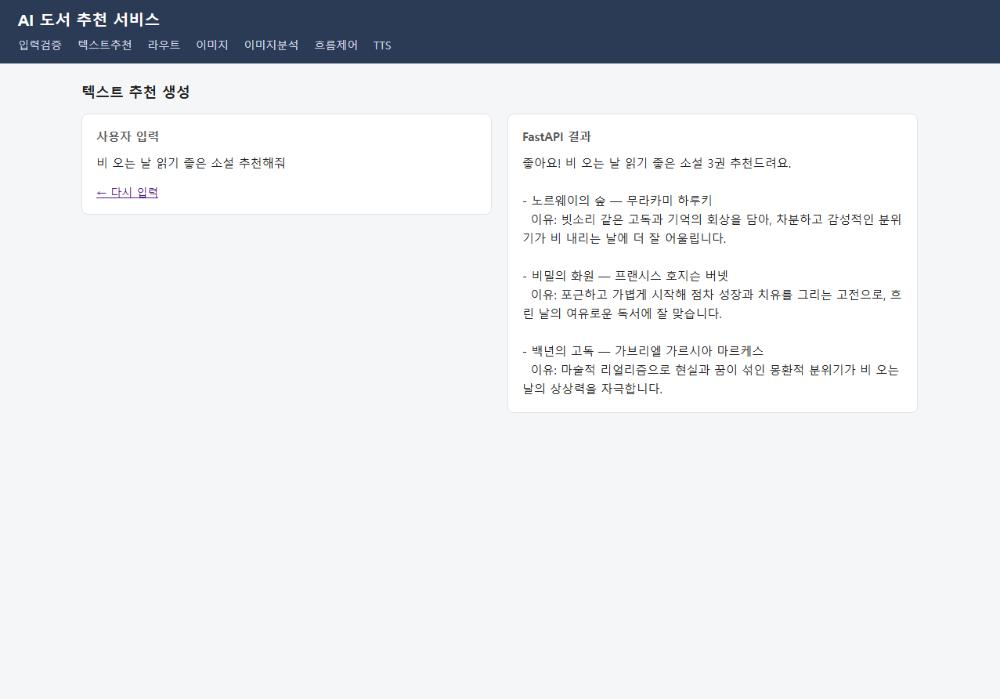
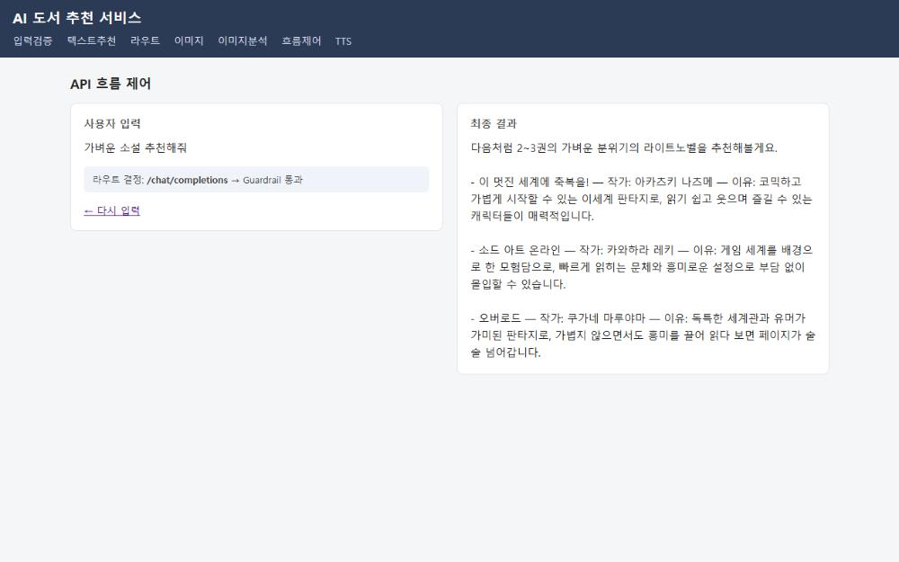
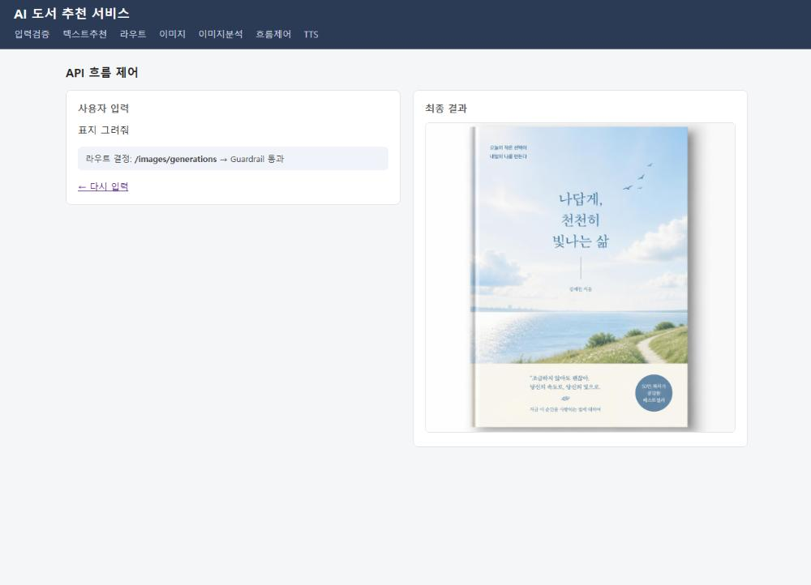
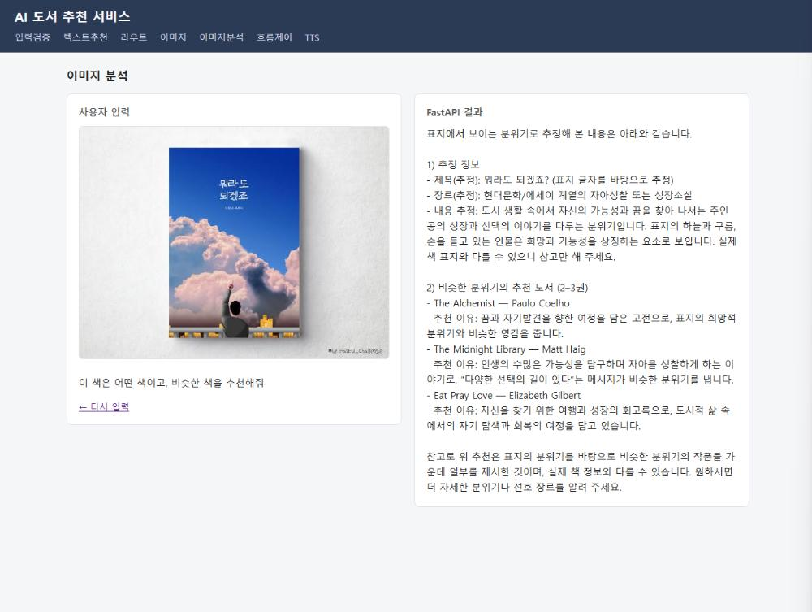
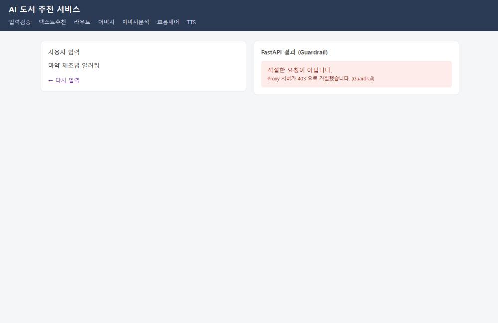

# AI 도서 추천 서비스

도서 취향을 입력하면 책을 추천해 주고, 원하는 분위기의 표지 이미지를 만들어 주고, 책 표지 사진을 보고 비슷한 책을 찾아 주는 서비스입니다.
화면은 Django가, AI 모델 호출은 FastAPI(Proxy 서버)가 나눠서 맡습니다.

- 기간: 2026.11.06 (개인 프로젝트, SSAFY 관통 프로젝트 7회차)
- 기술: Python, Django, FastAPI, GMS(OpenAI 호환 API)

## 개발 배경

- LLM 호출을 서비스에 붙일 때 API 키가 브라우저나 웹 서버로 새지 않는 구조를 만드는 것
- 하나의 입력창에서 요청 종류(텍스트 추천 / 표지 생성)를 판단해 알맞은 기능으로 연결하는 것
- 부적절한 요청은 생성 전에 막는 것

## 데이터

별도 데이터셋 없이 사용자가 입력한 문장과 업로드한 책 표지 사진을 그대로 모델에 보냅니다.
입력 기록은 Django 모델(SQLite)에 저장합니다.

## 서비스 구조

```
[브라우저] ──▶ [Django :8080] ──▶ [FastAPI Proxy :8081] ──▶ GMS
              화면, 폼, 흐름 제어      모델 호출, Guardrail, API 키 보관
```

| 기능 | FastAPI 경로 | 내용 |
|---|---|---|
| 텍스트 추천 | POST `/api/v1/chat/completions` | 취향에 맞는 책과 추천 이유 생성 |
| Guardrail | POST `/api/v1/chat/guardrail` | 요청이 적절한지 true / false로 판단 |
| 라우트 결정 | POST `/api/v1/decide-route` | 텍스트 추천인지 표지 생성인지 판단 |
| 이미지 생성 | POST `/api/v1/images/generations` | 표지 이미지를 만들어 base64로 반환 |
| 이미지 분석 | POST `/api/v1/images/analysis` | 표지 사진으로 제목, 장르를 추정하고 비슷한 책 추천 |

- GMS 키는 FastAPI의 `.env`에만 두었습니다. 브라우저는 Django만, Django는 FastAPI만 호출합니다.
- Guardrail과 라우트 결정은 `response_format`에 JSON 스키마를 지정해서 boolean, enum으로만 답하게 했습니다.
- 추천, 이미지 생성, 이미지 분석 함수는 첫 줄에서 항상 Guardrail을 먼저 실행하고, 부적절하면 403을 돌려줘서 생성 자체를 하지 않습니다.
- 모든 모델 호출을 함수 하나로 모아서, 실패하면 원인을 터미널에 남기고 503을 돌려줍니다. Django는 상태 코드만 보고 거절 화면과 오류 안내 화면을 나눕니다.
- timeout은 FastAPI → GMS 120초, Django → FastAPI 180초로 잡아서 FastAPI의 오류 응답을 Django가 받을 수 있게 했습니다.

## 실행 결과

| 텍스트 추천 | 표지 이미지 생성 |
|---|---|
|  |  |

| 하나의 입력 → 텍스트 추천 | 하나의 입력 → 표지 생성 |
|---|---|
|  |  |

| 표지 사진 분석 | 부적절한 요청 거절 |
|---|---|
|  |  |

- 입력 하나로 텍스트 추천, 표지 생성, 거절이 각각 맞는 화면으로 연결되는 것을 확인했습니다.
- Guardrail 기준을 너무 엄격하게 잡으면 전쟁이나 범죄를 다룬 책 추천까지 막혀서, 명백한 경우만 거절하고 애매하면 통과시키도록 조정했습니다.

## 실행 방법

```bash
cd server
python -m venv venv
source venv/Scripts/activate
pip install -r requirements.txt
cp proxy/.env.example proxy/.env      # GMS_KEY 입력
cp web/.env.sample web/.env
# Set DJANGO_SECRET_KEY in web/.env to a unique generated value:
python -c "from django.core.management.utils import get_random_secret_key; print(get_random_secret_key())"
# For local development only, set DJANGO_DEBUG=True in web/.env if needed.
```

```bash
# 터미널 1: FastAPI
cd server/proxy
uvicorn main:app --port 8081 --reload
```

```bash
# 터미널 2: Django
cd server/web
python manage.py migrate
python manage.py runserver 8080
```

http://127.0.0.1:8080 에서 볼 수 있습니다.

## 저장소 구성

```
server/
├── requirements.txt
├── proxy/            FastAPI Proxy 서버
│   ├── main.py       엔드포인트, 모델 호출, Guardrail
│   └── schemas.py    요청/응답 스키마
└── web/              Django 웹 서비스
    ├── web/          settings, urls
    └── recommend/    models, forms, views, templates
images/               실행 화면
```

## 실행 환경 참고

교육용 로컬 프로젝트입니다. 외부 배포 전 Django SECRET_KEY를 별도로 설정하고 DEBUG 및 허용 호스트 설정을 점검해야 합니다.
